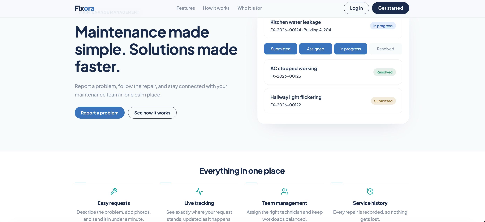
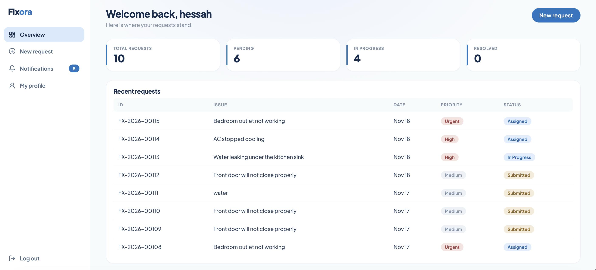
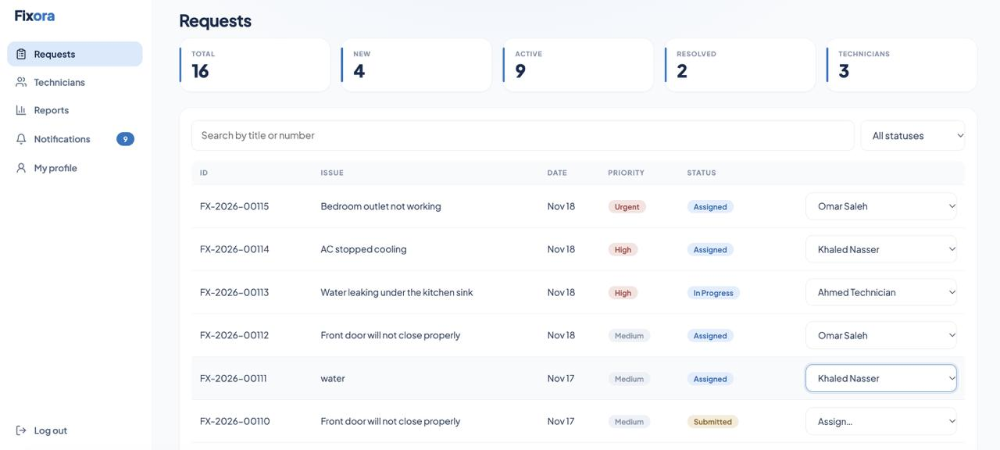
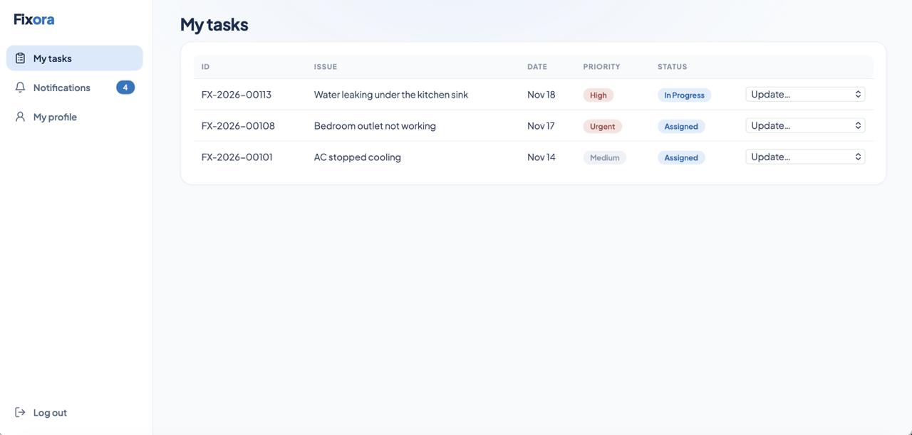
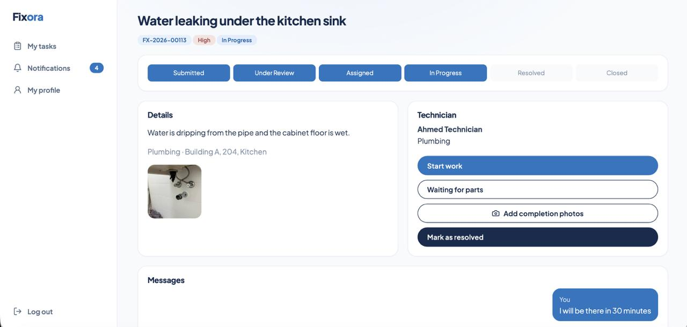
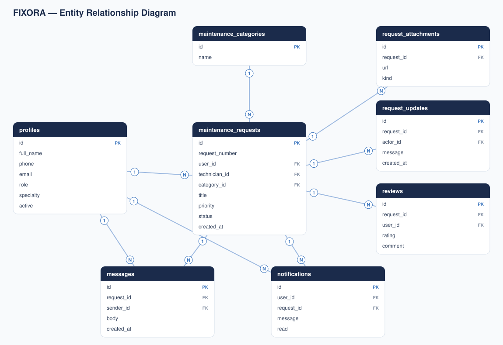

<div align="center">


# FIXORA

### Smart Maintenance Management Platform

A centralized maintenance platform that connects residents, administrators, and technicians through a streamlined request management experience.

<br />


<br />

**Live Demo:** https://fixora-nine-gilt.vercel.app/

</div>

---

## Overview

FIXORA is a full-stack maintenance management platform designed to simplify how maintenance issues are reported, assigned, tracked, and resolved.

The platform brings residents, administrators, and technicians together in one system. Residents can submit maintenance requests and follow their progress, administrators can manage requests and assign technicians, and technicians can update the status of their assigned tasks.

FIXORA aims to make maintenance operations more organized, transparent, and manageable through a centralized digital workflow.

## Screenshots

<div align="center">

### Landing Page


### Resident Dashboard


### Admin Dashboard


### Technician Dashboard


### Request Details


</div>

## The Problem

Traditional maintenance processes can become difficult to manage when requests are handled through scattered communication channels.

This can lead to:
- Poor visibility into request progress.
- Delays in assigning maintenance tasks.
- Difficulty coordinating between residents and technicians.
- Limited tracking of completed maintenance work.

## The Solution

FIXORA provides a centralized workflow where every maintenance request can be submitted, assigned, monitored, and reviewed.

Each user interacts with the platform according to their role, while real-time updates help keep the involved parties informed.

## Core Features

### Resident
- Submit maintenance requests with descriptions and photos.
- Track request status through its lifecycle.
- Communicate through request-based chat.
- Receive notifications and updates.
- Rate completed maintenance services.

### Administrator
- View and manage maintenance requests.
- Assign technicians to requests.
- Manage technician accounts.
- Search and filter requests.
- Monitor priorities and request statuses.
- View reports and analytics.

### Technician
- View assigned maintenance tasks.
- Access request details.
- Update maintenance progress.
- Communicate through request-based chat.

### Platform Capabilities
- Role-based authentication and access.
- Real-time request and dashboard updates.
- Request status timeline.
- Photo attachments.
- Notifications.
- Request-based messaging.
- Reports, charts, and CSV export.
- Database-level access control using Row Level Security.

## Request Lifecycle

<div align="center">

Submitted → Under Review → Assigned → In Progress
→ Waiting for Parts → Resolved → Closed

</div>

Requests move through a defined workflow, allowing residents and staff to follow maintenance progress from submission to closure.

## System Architecture

FIXORA uses a React frontend connected to Supabase services.

- **Frontend:** React application built with Vite.
- **Authentication:** Supabase Auth.
- **Database:** PostgreSQL managed through Supabase.
- **File Storage:** Supabase Storage.
- **Real-time Communication:** Supabase Realtime.
- **Security:** PostgreSQL Row Level Security policies.

## Database Design

The database was designed around the main entities and relationships required to manage maintenance operations.

The data model includes:
- Profiles
- Maintenance Requests
- Maintenance Categories
- Request Attachments
- Request Updates
- Messages
- Notifications
- Reviews

<div align="center">



*FIXORA Entity Relationship Diagram*

</div>

The database schema and SQL migrations are available in the [`supabase`](supabase/) directory.

## Technology Stack

| Layer | Technologies |
|---|---|
| Frontend | React 18, Vite |
| Routing | React Router |
| Backend Services | Supabase |
| Database | PostgreSQL |
| Authentication | Supabase Auth |
| Storage | Supabase Storage |
| Real-time | Supabase Realtime |
| Charts | Recharts |
| Icons | Lucide |
| Styling | CSS |
| Deployment | Vercel |

## Project Structure

```text
fixora/
├── docs/
│   ├── logo.svg
│   ├── er-diagram.svg
│   └── screenshots/
├── public/
├── scripts/
│   └── seed-demo-users.mjs
├── src/
│   ├── pages/
│   │   ├── Admin.jsx
│   │   ├── Auth.jsx
│   │   ├── Extras.jsx
│   │   ├── Landing.jsx
│   │   ├── RequestDetails.jsx
│   │   ├── Resident.jsx
│   │   ├── Shell.jsx
│   │   └── Tech.jsx
│   ├── App.jsx
│   ├── Splash.jsx
│   ├── auth.jsx
│   ├── index.css
│   ├── main.jsx
│   └── supabase.js
├── supabase/
│   ├── schema.sql
│   ├── 002_reviews.sql
│   ├── 003_demo_seed.sql
│   ├── 004_messages_notifications.sql
│   ├── 005_realtime_requests.sql
│   └── 006_security_hardening.sql
├── .env.example
├── .gitignore
├── index.html
├── package.json
├── vercel.json
└── vite.config.js

```

## Getting Started

### Prerequisites

- Node.js
- npm
- A Supabase project

### Installation

1. Clone the repository:

```bash
git clone https://github.com/ittsraghad/fixora.git
cd fixora
```

2. Install dependencies:

```bash
npm install
```

3. Configure environment variables.

Create a `.env` file in the project root using `.env.example` as a reference:

```env
VITE_SUPABASE_URL=your_supabase_project_url
VITE_SUPABASE_ANON_KEY=your_supabase_publishable_key
```

4. Configure the Supabase database by applying the SQL schema and migration files in the appropriate order.

5. Start the development server:

```bash
npm run dev
```

6. Create an account and access the platform.

## Development Process

The project was developed through several stages:

1. Requirements analysis and role definition.
2. Entity Relationship Diagram design.
3. Relational database mapping.
4. Database implementation using PostgreSQL.
5. Authentication and role-based access implementation.
6. Frontend development for the three user roles.
7. Real-time updates, notifications, and messaging integration.
8. Security policies and deployment preparation.

## Author

**Raghad **

Information Technology Student

[GitHub](https://github.com/ittsraghad)

</div>

